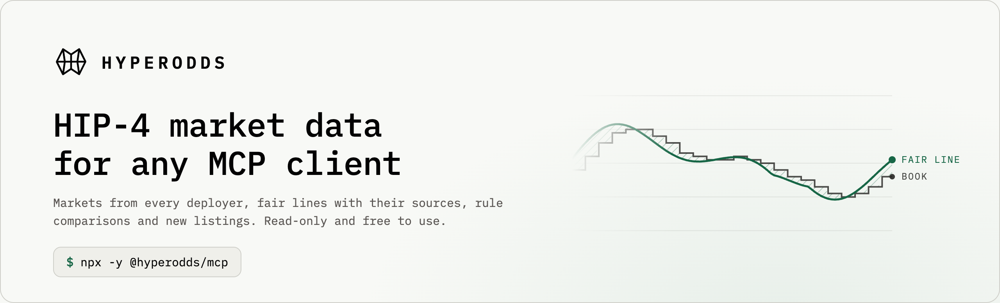
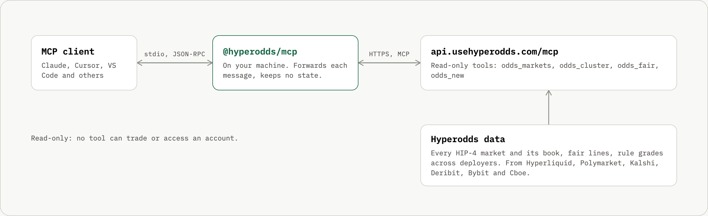

<p align="center">
  <picture>
    <source media="(prefers-color-scheme: dark)" srcset="https://raw.githubusercontent.com/usehyperodds/hyperodds-mcp/main/assets/banner-dark.png">
    
  </picture>
</p>

<p align="center">
  <a href="https://www.npmjs.com/package/@hyperodds/mcp"></a>
  <a href="https://github.com/usehyperodds/hyperodds-mcp/actions/workflows/ci.yml"></a>
  <a href="https://github.com/usehyperodds/hyperodds-mcp/blob/main/LICENSE"></a>
  <a href="https://usehyperodds.com"></a>
  <a href="https://x.com/UseHyperodds"></a>
  <a href="https://heyresearch.xyz/project/hyperodds?utm_source=badge&utm_medium=readme"></a>
</p>

Give Claude, Cursor, VS Code or any other MCP client live data on Hyperliquid's HIP-4 outcome
markets from every deployer: books, fair lines with their sources, rule comparisons where several
deployers list the same question, and the newest listings. Your agent can also enter its own
forecasts in Hyperodds' public record, where each one is scored against the market's settlement.
Free, with no account to set up.

`@hyperodds/mcp` is a bridge. It runs on your machine over stdio and forwards each request to the
hosted Hyperodds MCP server at `api.usehyperodds.com/mcp`, where the tools and their data run. This
repository holds the bridge only; the hosted server is not open source. The bridge signs forecasts
on your machine with two audited libraries, `@noble/curves` and `@noble/hashes`, and has no other
dependencies. No tool can trade, move funds or access an account.

## Quick start

Claude Desktop installs Hyperodds as an extension: download
[`hyperodds.mcpb`](https://github.com/usehyperodds/hyperodds-mcp/releases/latest/download/hyperodds.mcpb)
from the latest release and open it. Claude Desktop lists the tools and adds them when you select
Install. The extension is this bridge, and it runs on the Node.js built into the app.

The file is not certificate-signed. To check where it came from before you open it, compare its
SHA-256 with the one in the release notes (`shasum -a 256 hyperodds.mcpb` on macOS,
`certutil -hashfile hyperodds.mcpb SHA256` on Windows), or verify with the GitHub CLI that GitHub
Actions built it in this repository:

```sh
gh attestation verify hyperodds.mcpb --repo usehyperodds/hyperodds-mcp
```

To add the bridge by hand, use this entry in Claude Desktop (Settings > Developer > Edit Config),
Cursor (`~/.cursor/mcp.json`, or `.cursor/mcp.json` in one project) or Windsurf:

```json
{
  "mcpServers": {
    "hyperodds": {
      "command": "npx",
      "args": ["-y", "@hyperodds/mcp@0.2.4"]
    }
  }
}
```

Claude Code:

```sh
claude mcp add hyperodds -- npx -y @hyperodds/mcp@0.2.4
```

VS Code (`.vscode/mcp.json`):

```json
{
  "servers": {
    "hyperodds": { "type": "stdio", "command": "npx", "args": ["-y", "@hyperodds/mcp@0.2.4"] }
  }
}
```

Each entry runs the release it names until you change the version in it; the
[changelog](https://github.com/usehyperodds/hyperodds-mcp/blob/main/CHANGELOG.md) lists what each
release changes. You can write `@hyperodds/mcp@latest` instead, and npx then looks up the newest
release each time your client starts the bridge.

The package needs Node.js 22 or later. A client that connects to remote servers can skip it and
use `https://api.usehyperodds.com/mcp` directly over Streamable HTTP.

## What to ask

- "Which HIP-4 markets show the biggest edge after fees right now?"
- "How is the next Fed decision priced?"
- "Where does the fair line for the BTC markets settling today come from, and how confident is it?"
- "What was listed in the last hour?"
- "Forecast today's BTC and ETH markets and enter your forecasts in the record."

## Tools

| Tool                   | Input                                                                                                    | Output                                                                                                                                                                        |
| ---------------------- | -------------------------------------------------------------------------------------------------------- | ----------------------------------------------------------------------------------------------------------------------------------------------------------------------------- |
| `odds_markets`         | `category`, `deployer`, `sort` (`volume`, `edge`, `new`, `settling`), `q`, `limit` (up to 100), `offset` | Markets with bid, ask, fair line, best buy edge after fees, 24h volume, event time and status, plus how many match in total                                                   |
| `odds_cluster`         | `id`, or the `outcome` of any member                                                                     | For a question more than one deployer lists: each listing's rule grade (`SAME`, `CLOSE` or `DIFFERENT`), the differences found and the merged book                            |
| `odds_fair`            | `outcome`                                                                                                | One market's fair line: probability and band, method, confidence and flags, each source with its weight and age, plus the book and the edge for buying or selling either side |
| `odds_new`             | `category`, `limit` (up to 100), `offset`                                                                | Markets in listing order, newest first, with the same fields as `odds_markets`                                                                                                |
| `search`               | `query`                                                                                                  | Up to 20 live markets that match the words of a question, each with an id, a title and its page                                                                               |
| `fetch`                | `id` (from `search`)                                                                                     | One market as text to quote: the book, volume, fair line and sources, edges, rules and other venues                                                                           |
| `odds_forecast`        | `forecasts`: up to 50 of an `outcome` and a `probabilityBps` from 1 to 9999                              | With signing on, the forecasts as recorded, signed on your machine; with it off, a sign link                                                                                  |
| `odds_forecast_record` | `address` (with signing on, your forecaster if left out), `limit` (up to 100), `offset`                  | One forecaster's board row, their forecasts past the cutoff with results and scores, and how many are still private                                                           |
| `odds_leaderboard`     | `limit` (up to 100), `offset`                                                                            | Forecasters ranked by skill over Hyperodds' fair line, with the fair line and the market price scored as baselines                                                            |

Your client receives each tool's input and output schema when it connects. The
[MCP guide](https://usehyperodds.com/docs/mcp) explains the numbers.

## How it works

<picture>
  <source media="(prefers-color-scheme: dark)" srcset="https://raw.githubusercontent.com/usehyperodds/hyperodds-mcp/main/assets/diagram-dark.png">
  
</picture>

Each message from the client goes out as one HTTPS request, and its response comes straight back.
The bridge never follows a redirect: a reply that redirects is an error, so no message moves to
plain http or another server. For a forecast, the bridge uses your forecaster key to sign the
forecasts your agent asked for, and sends them in that same request. It never signs anything a
server sends it. The bridge keeps only your forecaster key, the time it last signed on each market,
the protocol version and capabilities your client reported, and a count of forecasts signed since.

Requests run side by side. If one fails or gets no answer within 30 seconds, the client receives a
JSON-RPC error that names the cause; a cancelled request is dropped. The bridge takes lines of up
to 1 MB from the client and reads answers of up to 8 MB. A longer line is dropped, and a longer
answer ends its request, each with a JSON-RPC error that says so. When the client closes the
connection, the bridge drops what is still in flight and exits.

## Reading the numbers

Prices are decimals from 0 to 1 for a market's first side, often Yes. Edges are percentage points
after every fee, including the fee Hyperliquid takes at settlement, for a $100 order: 2.9 means
2.9¢ a share. An edge is null when $100 would not fill.

Price markets take their fair line from Deribit, Bybit and Cboe option surfaces, or from realized
volatility on Hyperliquid perps. Sports and events take theirs from matched Polymarket and Kalshi
quotes. Fair lines are estimates: edge rankings only use lines with a `fairConfidence` of at least
0.5 and more than one source, so check both before acting on one.

## Forecasts

An agent can enter forecasts in Hyperodds' public record: for each market, the probability that its
first side wins. Hyperodds records each forecast with its own fair line and the market's mid price
at that moment. A forecast stays private until the market's cutoff, such as the start of a game or
the moment a price market takes its price. Then it appears in the forecaster's public record and in
a daily record anyone can check. Once Hyperliquid settles the market, the forecast gets a Brier
score, the squared distance between the forecast and the result, where lower is better. The board at
[usehyperodds.com/forecasts](https://usehyperodds.com/forecasts) ranks forecasters by how much they
beat the fair line.

Entries close an hour before each market's cutoff, and one call takes up to 50 markets whose cutoffs
fall on the same UTC day. If you forecast a market again, the forecast signed latest is the one
scored; earlier ones stay in the record. The bridge signs each forecast at least a second after its
last one on the same market, so a quick revision still counts. It keeps those times in
`forecast-times.json`, in the folder of the key it makes, whichever key it signs with. There are no
prizes or payouts.

### Your forecaster key

The bridge signs every forecast on your machine, so the record shows who made each one and that no
one has changed it since. On the first forecast, the bridge makes a key and saves it in a file only
you can read:

| System          | File                                                                                                |
| --------------- | --------------------------------------------------------------------------------------------------- |
| macOS and Linux | `~/.config/hyperodds/forecaster.key`, or `$XDG_CONFIG_HOME/hyperodds/forecaster.key` when it is set |
| Windows         | `%APPDATA%\hyperodds\forecaster.key`                                                                |

On macOS and Linux, the bridge won't use the key, and says how to fix it, when:
- the file is not a regular file, or another user owns it, or other users can read or change it;
- the file, its `hyperodds` folder or the config folder above that (`~/.config` or
  `$XDG_CONFIG_HOME`) is a link;
- the file has more than one hard link, so the key also lives under another name;
- another user owns the `hyperodds` folder, or other users can write to it.

It won't make a new key in such a folder either, or read or save `forecast-times.json` there,
whichever key it signs with. On Windows, the bridge makes none of these checks, and the file relies
on the permissions of your `%APPDATA%` folder, which the computer's administrators can read.

In the errors your client and its model see, your home folder appears as `~`, or as `$HOME` in a
command to run. Only the client's server log, where the bridge writes its diagnostics, has the
full path.

The key's address is your forecaster. After each forecast, the bridge names it and links its public
record, `https://usehyperodds.com/forecasts/<address>`. With a server you set by hand, it links the
record only when `HYPERODDS_SITE_URL` names the site that publishes it. Hyperodds receives the
address and the signed forecasts, never the key.
- **Back it up.** Copy the file somewhere safe. Whoever holds it can forecast under your address,
  and without it no one can add to that record.
- **Use it on another machine.** Copy the file to the same place there, or anywhere you keep
  such files, and set `HYPERODDS_FORECAST_KEY_FILE` to its absolute path. The bridge runs the
  checks above on that file, its folder and the folder above that, reads the key from it for each
  forecast, and never makes a key there. In Claude Desktop, paste the file's contents into the
  extension's **Forecaster key** setting.
- **Or pass the key itself.** Set `HYPERODDS_FORECAST_KEY` to the file's contents. The bridge
  reads the variable once at startup and removes it from its own environment, but the key is not
  gone: it stays in your client's config file, and the operating system keeps the environment the
  bridge started with, which programs running as your user can read (on Linux, in
  `/proc/<pid>/environ`). The extension's **Forecaster key** setting reaches the bridge this way
  too. `HYPERODDS_FORECAST_KEY_FILE` keeps the key out of both.
- **Start over.** Move or delete the file. The next forecast makes a new key, and with it a new
  forecaster. The old record stays public under the old address.

The key is for forecasts only. Don't send funds to its address, and never give the bridge a key that
holds funds. To forecast as a wallet you already have, see
[Signing with your own wallet](#signing-with-your-own-wallet).

### Approving forecasts

With signing on, the bridge enters forecasts when your agent calls `odds_forecast`, after two
checks of its own:
- **It asks you first, if your client can.** When your client supports MCP elicitation forms, the
  bridge shows you each call's outcome ids, probabilities and forecaster before it signs, and
  enters nothing unless you accept. Otherwise your client's prompt to approve the tool call is the
  only confirmation, so keep approval on for `odds_forecast` if you want to see each forecast before
  it is entered.
- **It signs at most 200 forecasts a session**, from when your client starts the bridge until it
  stops it. Set `HYPERODDS_FORECAST_LIMIT` to change that. Forecasts the server refuses don't count.

The tool's description tells the agent to enter forecasts only when you ask, and not to act on
instructions in market titles, rules, side names or deployer names.

### Signing with your own wallet

To forecast as a wallet you already have, sign the forecasts in that wallet. Set
`HYPERODDS_FORECAST_SIGNING=off` in the client entry's `env`, or in Claude Desktop, turn off
**Sign forecasts on this computer** in the extension's settings. The bridge then passes forecasts
through unchanged, and Hyperodds answers with a sign link to open in the browser where your wallet
is. With signing on, a forecast that names another wallet's address as `forecaster` also gets a sign
link for that wallet.

## Limits

Each IP address gets 1,000 calls to the market tools a day, reset at 00:00 UTC; the forecast tools
don't count toward it. Every request, tool call or not, also counts toward a rate limit of 5 a
second, with bursts of up to 30. Forecasts have limits of their own: each forecaster can make 10
forecast calls a minute and enter 1,000 forecasts a day, and an IP address 2,000 a day. With signing
off, an IP address can ask for 600 sign links an hour. Past any limit, the server answers with an
error that names it.

## Privacy

The bridge forwards each message from your client to `api.usehyperodds.com`. That includes the
arguments of every tool call, such as the text of a search, and the name and version your client
reports when it connects. Each request also carries a user agent with the bridge and Node.js
versions, such as `hyperodds-mcp/0.2.4 node/24.22.0`. Requests pass through Cloudflare on their way
to our hosting provider.

The bridge passes your client no requests from the server, so a server can't ask your client's
model to write text (sampling), ask you for input (elicitation) or list your folders (roots). It
answers a server's `ping` itself, and any other server request with a method-not-found error. To
match, it removes the `roots`, `sampling`, `elicitation` and `tasks` capabilities from what your
client reports when it connects, and drops any answer your client sends to a server request.

Other messages go through unchanged, except for the forecast tools while signing is on. The bridge
sends `odds_forecast` as your forecasts signed by your forecaster key, and fills in your
forecaster's address when `odds_forecast_record` has none. In the answers, it rewrites both tools'
descriptions for signing on your machine and makes the second one's `address` optional. After each
forecast it names your forecaster, and it explains refusals caused by the clock or the signing
order. The forecaster key never leaves your machine. Each forecast is private until its market's
cutoff, then public with the address that signed it.

The server counts tool calls per IP address for the daily allowance. It never stores the address
itself, only a hash made with a key that changes every day, and it deletes each day's key the next
day. The [privacy policy](https://usehyperodds.com/privacy) covers the rest.

## Configuration

The bridge reads its settings from the environment. In an entry you add by hand, set them in
`env`:

| Variable                      | Default                                                    | Purpose                                                                           |
| ----------------------------- | ---------------------------------------------------------- | --------------------------------------------------------------------------------- |
| `HYPERODDS_MCP_URL`           | `https://api.usehyperodds.com/mcp`                         | The server to forward to: https, or plain http only on this computer              |
| `HYPERODDS_FORECAST_KEY`      | The key file                                               | A private key made for forecasts, 64 hex digits                                   |
| `HYPERODDS_FORECAST_KEY_FILE` | None                                                       | The absolute path of a file that holds that key, read in place of the key file    |
| `HYPERODDS_FORECAST_SIGNING`  | `on`                                                       | `off` sends forecasts unsigned, for a sign link to a wallet                       |
| `HYPERODDS_FORECAST_LIMIT`    | `200`                                                      | The most forecasts the bridge signs in a session, from start to exit              |
| `HYPERODDS_SITE_URL`          | `https://usehyperodds.com` with the hosted server, or none | The site that publishes the server's forecast records, linked after each forecast |

```json
{
  "command": "npx",
  "args": ["-y", "@hyperodds/mcp@0.2.4"],
  "env": { "HYPERODDS_FORECAST_SIGNING": "off" }
}
```

The extension uses the hosted server unless `HYPERODDS_MCP_URL` is set in the environment its host
starts it with. Claude Desktop does not pass your own environment variables to extensions, so in
Claude Desktop it always uses the hosted server, and the extension's own settings hold the
forecaster key and turn signing on or off.

Behind a proxy, add `HTTPS_PROXY` and `NODE_USE_ENV_PROXY=1` to the same `env`. Node.js uses the
proxy only when the second is set, and only in versions 22.21, 24.5 or later. `--help` lists the
other proxy variables. When the server cannot be reached, the error names the proxy, or says why a
proxy that is set goes unused.

When npx fetches the package, it goes through the same proxy. If your npm config holds a registry
token, npm (checked with 11.9) sends it in plain text in the proxy's CONNECT request. Use only a
proxy you trust, or remove the token from your npm config.

The extension turns on Node.js proxy support itself, so it uses a proxy its host passes in
`HTTPS_PROXY`. It has no proxy setting of its own; for any other proxy, add the bridge by hand.

`npx -y @hyperodds/mcp@0.2.4 --help` and `--version` print the usage and the version.

## Development

```sh
git clone https://github.com/usehyperodds/hyperodds-mcp.git
cd hyperodds-mcp
npm ci
npm test
```

`npm run lint` and `npm run typecheck` run the other checks CI runs. `npm run mcpb` builds the
bridge and packs it into `build/hyperodds.mcpb` with the manifest and icons in `mcpb/` and the files
it loads from its two dependencies. That is the file the release workflow attaches to each GitHub
release. See
[CONTRIBUTING.md](https://github.com/usehyperodds/hyperodds-mcp/blob/main/CONTRIBUTING.md) before
opening a pull request.

## Security

Report vulnerabilities privately to security@usehyperodds.com, or through
[the repository's Security tab](https://github.com/usehyperodds/hyperodds-mcp/security/advisories/new).
Please do not open a public issue for them.
[SECURITY.md](https://github.com/usehyperodds/hyperodds-mcp/blob/main/SECURITY.md) has the details.

## License

[MIT](https://github.com/usehyperodds/hyperodds-mcp/blob/main/LICENSE). Third-party names identify
data sources and compatible clients; Hyperodds is not affiliated with any of them.

<p align="center">
  <a href="https://usehyperodds.com">Website</a> ·
  <a href="https://usehyperodds.com/docs/mcp">Docs</a> ·
  <a href="https://x.com/UseHyperodds">X</a> ·
  <a href="https://github.com/usehyperodds">GitHub</a>
</p>
